


 

&nbsp;
&nbsp;
&nbsp;

 

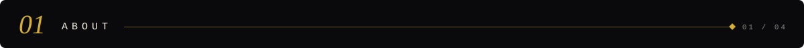

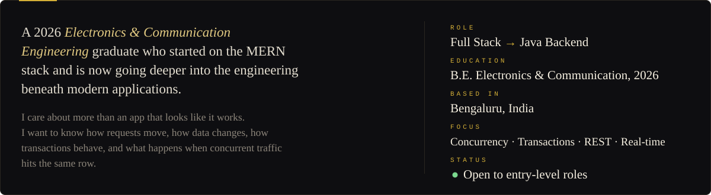

 

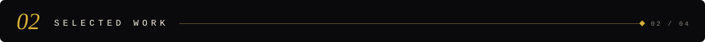

<table>
<tr>
<td width="50%" valign="top" align="center">

<a href="https://github.com/JaganReddy-33/CravePulse">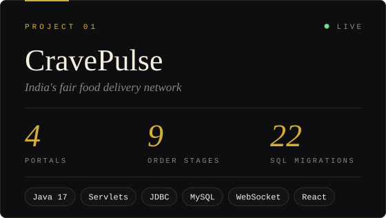</a>

</td>
<td width="50%" valign="top" align="center">

<a href="https://github.com/JaganReddy-33/Seatline_Atomic-Booking-Engine">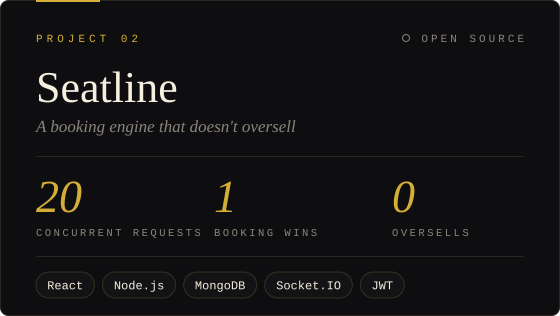</a>

</td>
</tr>
<tr>
<td valign="top" align="center">

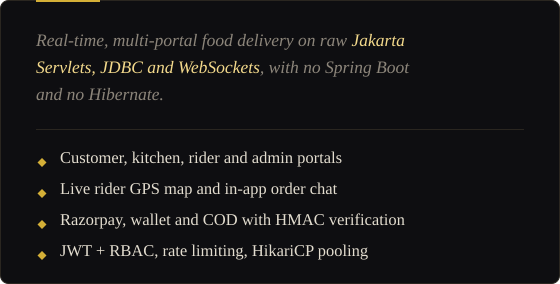

</td>
<td valign="top" align="center">

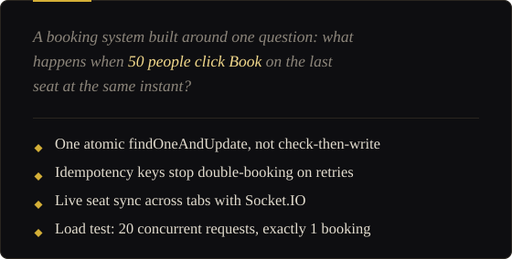

</td>
</tr>
</table>

 

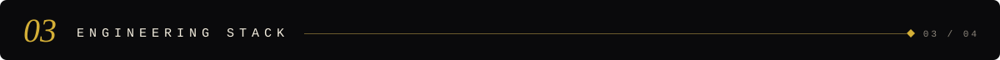

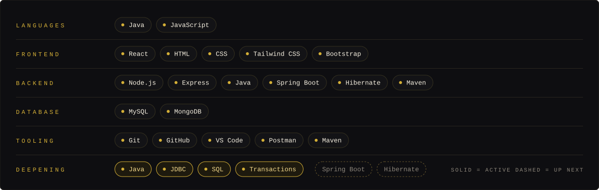

 

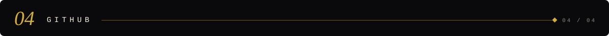

 

 

  

